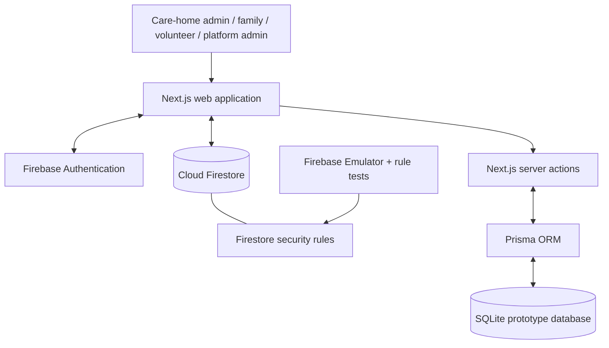

# Aastha Technical Design Document

## 1. Purpose and scope

Aastha is a hackathon prototype for a community-powered elder-care coordination service. It brings together care homes/NGOs, family members, and verified local volunteers so care status and urgent requests can be seen by the people responsible for them.

The prototype demonstrates workflows and access-control concepts; it is not designed or approved for clinical, emergency-dispatch, or production use.

## 2. Architecture

### Data boundaries

The current prototype includes two intentionally separate persistence paths:

1. **Firebase Authentication and Cloud Firestore** power browser sign-in, role profiles, live welfare views, organization registration, and Firestore security-rule enforcement.
2. **Prisma and local SQLite** support server-side prototype actions and deterministic sample data, including care logs, volunteer profiles, and emergency alerts.

They are not a production-grade synchronized data architecture. A production build should choose or explicitly synchronize a single system of record, add server-side authorization to every write path, and introduce migrations, monitoring, backups, and audit trails.

## 3. Main components

| Component | Responsibility |
| --- | --- |
| Next.js App Router pages | Landing, login, organization registration, pending approval, and role-specific dashboards. |
| `AuthContext` | Observes Firebase Authentication state and retrieves the matching Firestore user profile. |
| Firebase Authentication | Email/password identity for browser users. |
| Cloud Firestore | Organization, user, resident, medicine, care-update, alert, and volunteer workflow data. |
| `firestore.rules` | Enforces role, organization, volunteer verification, family linkage, and alert-transition restrictions. |
| Prisma / SQLite | Local server-action prototype data and deterministic demo seed. |
| Firebase Emulator Suite | Local execution target for authorization policy tests. |

## 4. Roles and authorizations

| Role | Prototype permissions |
| --- | --- |
| Platform administrator | Reviews organizations and can manage protected platform records. |
| Organization administrator | Manages records belonging to an approved organization; can verify volunteers in that organization. |
| Family member | Reads records only for residents linked to their account. |
| Verified volunteer | Views and progresses eligible alerts only within an approved organization. |
| Unverified volunteer | Cannot access protected resident or alert information. |

The Firestore policy protects these relationships at the database layer. UI visibility is supplementary and must not be treated as authorization.

## 5. Key workflows

### Organization onboarding

1. A care home or NGO submits its organization details and documents.
2. The organization starts in `pending` status.
3. A platform administrator approves or rejects it.
4. Only approved organizations receive the organization-admin data permissions described in the rules.

### Family access

1. A family member has a Firebase user profile.
2. The resident document lists the member's UID in `familyUserIds`.
3. The policy allows that member to read the linked resident and related welfare information.

### Volunteer emergency response

1. A verified volunteer in the resident's approved organization can read an open alert.
2. The volunteer may accept it, record arrival, resolve it, or decline it only through the allowed state transitions.
3. An open, unaccepted alert may be escalated after the configured 60-second window.
4. Each permitted transition appends an entry to the alert timeline.

## 6. Data model

### Firestore collections

| Collection | Example contents |
| --- | --- |
| `users` | Role, organization membership, verification state, contact profile. |
| `organizations` | Organization information, applicant, approval status. |
| `orgDocuments` | Organization application documents. |
| `residents` | Resident profile, organization, linked family UIDs. |
| `medicines`, `doseLogs`, `healthUpdates` | Welfare, medicine, and care-tracking records. |
| `alerts` | Emergency/care alert status, assigned volunteer, and timeline. |

### Prisma / SQLite models

`User`, `VolunteerProfile`, `SeniorResident`, `CareLog`, and `EmergencyAlert` model the local prototype data. NextAuth account/session models are also present for the credentials-auth experiment.

## 7. Security and privacy design

- Authentication state and role profiles are validated against Firebase rather than trusting a role selected in the interface.
- Firestore rules prevent users from changing their own role, organization membership, or verification status.
- Rule tests validate allowed and denied cases for organization boundaries, family links, volunteer verification, and emergency escalation timing.
- Environment-specific values are stored in ignored `.env*` files. `.env.example` contains placeholders only.
- The repository uses fictional demo data. Real health or identification information must not be committed.

## 8. Testing strategy

- **Lint/build:** `npm run lint` and `npm run build` check the app code and production compilation.
- **Security-policy tests:** `npm run test:rules` runs Node tests against a Firestore emulator.
- **Manual prototype checks:** sign in as each role; confirm that role pages, resident visibility, alert progression, and organization approval states behave as expected.

See [Sample Data & Test Cases](SAMPLE_DATA_AND_TESTS.md) for the individual test scenarios.

## 9. Production considerations

Before handling real users or health-related data, the system needs a formal privacy review, accessibility testing, security assessment, audit logging, rate limits, backup and recovery procedures, monitoring, data-retention and consent controls, and a clearly defined emergency-response operating model.
